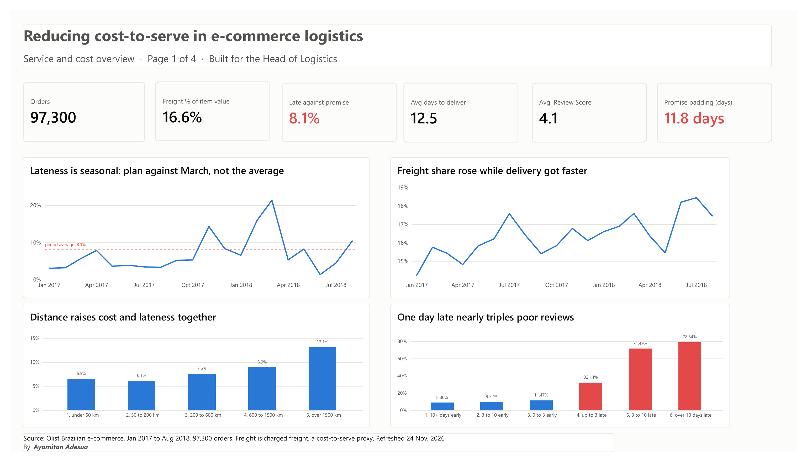
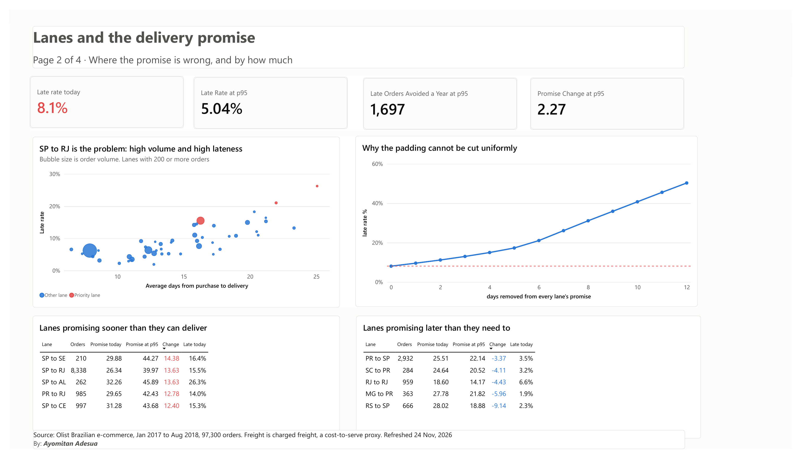
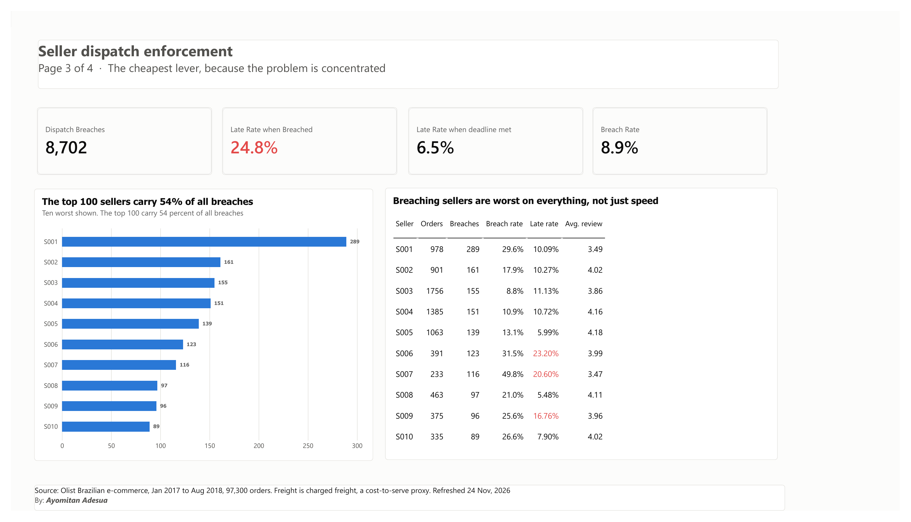
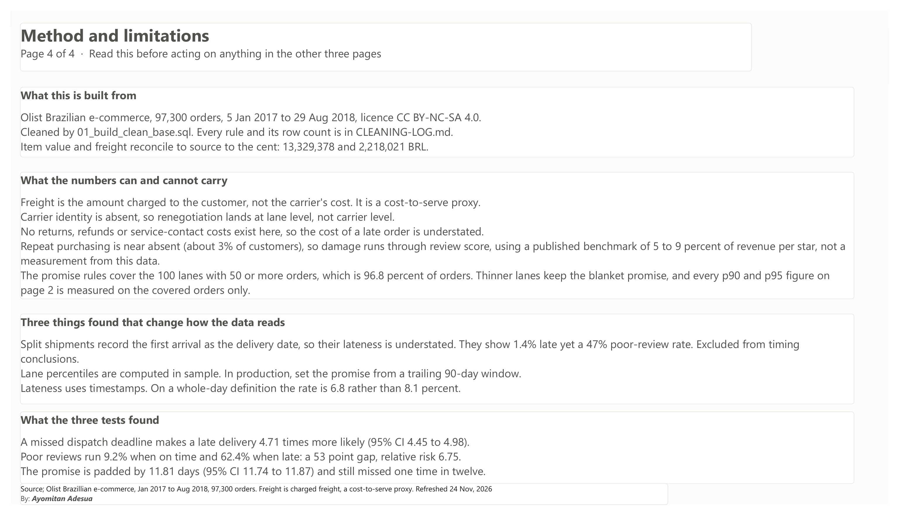

# Reducing cost-to-serve in e-commerce logistics

**Result:** found that a blanket delivery promise, not freight cost, was
the main driver of service failure. Setting the promise per lane cuts
lateness from 8.1 to 5.0 percent, about **1,697 fewer late orders a
year**, while shortening the promise on 42 of 100 lanes. Also identified
that a missed seller dispatch deadline makes a late delivery **4.71
times more likely** (95% CI 4.45 to 4.98), with the top 100 sellers
carrying 54.3 percent of all breaches.

**Stack:** SQL (DuckDB), Python (pandas, statsmodels, scikit-learn),
Excel (Power Query, scenario model), Power BI (DAX, 4-page report)

**Role relevance:** Operations Analyst, Supply Chain Analyst, Logistics
Analyst, Business Analyst, BI Analyst




---

## The problem

A Brazilian e-commerce marketplace charges customers freight and bears
the consequences of how long delivery takes. Freight runs at 16.6
percent of item value, which looks like a cost-recovery opportunity.
The Head of Logistics has a fixed budget and four possible levers:
re-route, renegotiate, enforce seller dispatch deadlines, or recalibrate
the delivery promise. The question is which to fund, in what order, and
for how much return.

## The decision this answers

Which delivery lanes, sellers and product classes to intervene on next
quarter, and with which lever on each, ranked by expected value.

## Data

[Brazilian E-Commerce Public Dataset by Olist](https://www.kaggle.com/datasets/olistbr/brazilian-ecommerce)
(Kaggle, CC BY-NC-SA 4.0). 99,441 orders across 9 tables, September 2016
to October 2018. After cleaning and scoping: **97,300 orders**, January
2017 to August 2018, 3,095 sellers, all Brazilian states.

Item value and freight reconcile to source to the cent after cleaning:
13,329,378 and 2,218,021 BRL. Every cleaning rule and its row count is
in `03-data-clean/CLEANING-LOG.md`.

## Approach

1. Business framing with a named decision maker, a deadline and a cost
   of being wrong (`01-brief/stage-1-business-brief.md`)
2. Data dictionary, grain, referential integrity and known biases
   (`01-brief/stage-2-data-dictionary.md`)
3. Cleaning and validation, every rule logged with rows affected
   (`04-sql/01_build_clean_base.sql`)
4. Exploration across lanes, distance, split shipments and seasonality
   (`04-sql/02_exploration.sql`)
5. Three hypothesis tests, cut down from six on purpose
   (`05-notebooks/stage5_tests.py`)
6. Quantification with every assumption named and a sensitivity grid
   (`08-report/stage-6-quantification.md`)
7. Excel scenario model and a 4-page Power BI report
8. Ranked recommendations with owners and verification metrics

## Findings

**The promise is the problem, and the obvious fix is wrong.** The
promise is padded by 11.81 days against a 12.5-day actual delivery, yet
missed one time in twelve. Cutting three days off every lane takes
lateness from 8.1 to 13.1 percent, because the padding covers lane
variance. Setting it per lane at the 95th percentile cuts lateness to
5.0 percent instead.

**Lateness damage is a cliff, not a slope.** Poor reviews run 9.2
percent on time and 62.4 percent late, a relative risk of 6.75. One day
late nearly triples the poor-review rate.

**The seller leg is 22 percent of the clock and most of the failure.** A
missed dispatch deadline multiplies late odds by 4.71, while doubling
distance barely moves them.

**Freight is not where the money is.** 47 percent of freight variation
is explained by distance, weight and item count, and the lanes above
that model are 2.12 percent of freight spend.

**A data artifact that would have produced a wrong finding.** Split
shipments appear 1.4 percent late against 8.2 percent, yet carry a 47
percent poor-review rate against 13 percent. Faster, rarely late and
rated far worse is not operationally possible: the delivery date records
the first parcel to arrive, not the last. Their lateness is excluded
from all timing conclusions and the finding is reported rather than
used.

## The dashboard

Four pages, built in Power BI from the cleaned fact table and the lane
aggregates. Every page leads with a finding rather than a chart name,
and page 4 carries the method and the limitations so no number on the
first three pages is quotable without its caveat.

Open `07-dashboard/cost-to-serve-dashboard.pbix`, or read
`07-dashboard/cost-to-serve-dashboard.pdf`.







Measures are in `07-dashboard/measures.dax`, the build specification in
`07-dashboard/POWER-BI-BUILD-SPEC.md`.

## Recommendations

Full version with cost, effort, owner and verification metric in
`08-report/stage-8-recommendations.md`.

| Rank | Lever | Effect a year | Confidence |
|---|---|---|---|
| 1 | Per-lane delivery promise, shortening lanes first | 1,697 fewer late orders | High, measured |
| 2 | Dispatch enforcement on the top 100 sellers | 564 fewer late orders, 300 fewer poor reviews | High on effect, low on money |
| 3 | Freight renegotiation on 16 north-east lanes | 28,224 BRL | High on the number, low on recoverability |
| 4 | Size peak capacity against March | Avoids failure at 2.63x the average late rate | High |

## Limitations

1. Freight is the amount charged to the customer, not the carrier's
   cost. It is used throughout as a cost-to-serve proxy.
2. Carrier identity is absent, so renegotiation lands at lane level.
3. No returns, refunds or service-contact costs exist in the data, so
   the cost of a late order is understated and every recommendation is
   worth more than modelled.
4. Repeat purchasing is near absent (about 3 percent of customers), so
   review damage is valued with a published benchmark of 5 to 9 percent
   of revenue per star (Luca 2011, HBS working paper 12-016), not a
   measurement from this business. This is the weakest number in the
   case and it sits in one editable cell of the Excel model.
5. Lane percentiles are computed in sample. In production the promise
   should be set from a trailing 90-day window, refreshed monthly.
6. Promise rules cover the 100 lanes with 50 or more orders, which is
   96.8 percent of orders.

## Repository

```
01-brief/        business brief, data dictionary
02-data-raw/     source CSVs, not committed, see the data link above
03-data-clean/   aggregates and CLEANING-LOG.md. fact_orders is rebuilt, not committed
04-sql/          cleaning and exploration SQL
05-notebooks/    profiling, tests, quantification, model build
06-excel/        cost-to-serve-model.xlsx, scenario driven, 83 live formulas
07-dashboard/    .pbix, PDF, page images, DAX measures, build spec
08-report/       findings, quantification, recommendations, executive summary
```

## Reproducing it

1. Download the Olist dataset into `02-data-raw/`
2. `python 05-notebooks/profile_raw.py 02-data-raw`
3. `python 05-notebooks/run_clean.py 02-data-raw 04-sql/01_build_clean_base.sql 03-data-clean`
4. `python 05-notebooks/stage5_tests.py 03-data-clean/fact_orders.parquet`
5. `python 05-notebooks/stage6_money.py 03-data-clean/fact_orders.parquet`
6. `python 05-notebooks/build_model_data.py` then `build_xlsx.py`
